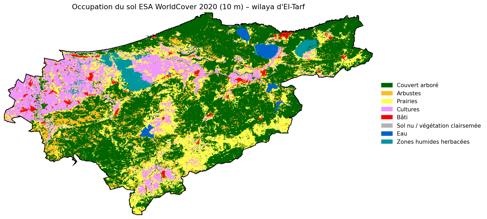
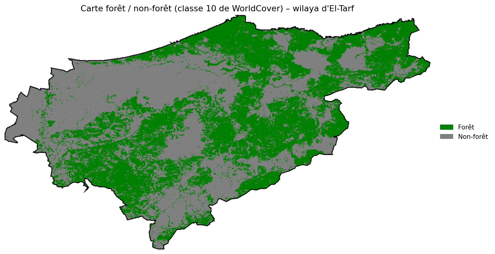
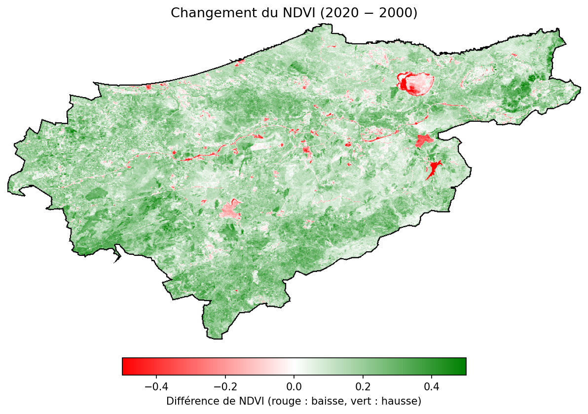

# 🛰️ El-Tarf Land Cover Classification

A Google Earth Engine script that maps land cover in the El-Tarf province of northeastern Algeria from Sentinel-2 imagery, using a Random Forest classifier. Based on my internship at ASAL (Algerian Space Agency).

## 🧠 How It Works

The model is trained on neighbouring Mediterranean countries with similar landscapes, then applied to El-Tarf.

1. **Study area:** El-Tarf boundary from FAO GAUL
2. **Training region:** Tunisia, Morocco, Spain, Italy, Greece and Turkey
3. **Imagery:** cloud-filtered Sentinel-2 median composites for 2020
4. **Features:** bands B2, B3, B4, B8, B11 and B12, plus the NDVI, NDWI, NDBI and MNDWI indices
5. **Labels:** 300 stratified sample points per class from ESA WorldCover
6. **Model:** Random Forest with 100 trees
7. **Output:** classified map shown next to WorldCover, and exported as a 10 m GeoTIFF to Google Drive

## 🗺️ Classes

Tree cover, shrubland, grassland, cropland, built-up, bare or sparse vegetation, water, wetland and other WorldCover classes.

## 🗺️ El-Tarf at a Glance

These maps come from my internship work on the same study area. They are built from ESA WorldCover and Landsat data, so they show the reference data and not the output of the Random Forest script. Map labels are in French.

**Land cover (ESA WorldCover 2020, 10 m).** The province covers about 3,580 km², and tree cover makes up about 46% of it.

**Forest and non-forest.** Forest dominates the centre, south and east, while the west is mostly cropland.

**NDVI change, 2000 to 2020.** Mean NDVI rose from about 0.43 to 0.58, with local drops mostly around water bodies and wetlands. The two dates come from different sensors (Landsat 5 and Landsat 8), so part of this gap may be due to the sensor change.

## 🚀 How to Run

You need a [Google Earth Engine](https://earthengine.google.com/) account.

1. Open the [Earth Engine Code Editor](https://code.earthengine.google.com/)
2. Paste `land_cover_classification.js` into a new script and click **Run**
3. Compare the layers in the map view
4. Start the export from the **Tasks** tab

## 📂 Data

| Dataset | Source | Use |
|---------|--------|-----|
| Sentinel-2 Surface Reflectance | `COPERNICUS/S2_SR_HARMONIZED` | Input imagery |
| ESA WorldCover v200 | `ESA/WorldCover/v200` | Training labels and reference map |
| FAO GAUL 2015 | `FAO/GAUL/2015` | Administrative boundaries |

## 👤 Author

**Adel Merad** — [GitHub](https://github.com/adelmerad)
